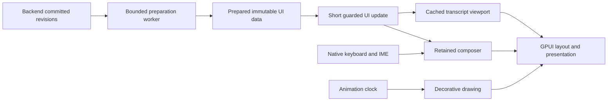

# GPUI responsiveness repair

The investigation on 12 October 2026 found expensive work on the main UI thread during keyboard dispatch, repeated transcript and subagent preparation during rendering, and a native pane outline that was hidden and shown again on animation frames. The repair separates preparation from presentation and separates the composer from transcript rendering. A normal optimized build is the performance target.

This work is isolated on `perf/gpui-responsiveness-20261012`. Commit `ed040e6` captures the GPUI checkout, including its existing uncommitted changes, before the responsiveness fixes. The main checkout and other sessions continued changing afterward. Baseline observations below identify the executable actually sampled; they are not measurements of every subsequent installed build.

The baseline GUI was PID 95225 at `/Applications/Monitter.app/Contents/MacOS/monitter-gpui-desktop`. Its SHA-256 was `1dcc5ae3cfb5957b0dc47e2c5272a35b0839672a9405b46988032c64476d5add`, identical to package `debug/build-1791820998948`. Package metadata reports a debug build with `visualExport: true`. Over a separate 5.067-second observation, it accumulated 5.330 CPU seconds, approximately 105% of one core. This was an uncontrolled live workload, not an idle benchmark.

Two macOS stack samples locate the work:

| Main thread stack | First capture | Second capture |
| --- | ---: | ---: |
| Window drawing | 98.90% | 68.70% |
| ChatPane rendering | 46.06% | 31.19% |
| Subagent badge count | 25.12% | 15.65% |
| Backend state publication | 0.00% | 29.12% |

These are inclusive, overlapping stack observations from 1,461 and 965 main-thread samples. They are not percentages to add together, counts of frames, or measured keystroke latency. The first capture was dominated by native keyboard dispatch. The second caught background state publication as well. Raw captures, demangled symbols, binary identity, and summaries are in `artifacts/gpui/responsiveness/`; `scripts/gpui-sample-summary.py` reproduces the percentages from the demangled captures.

The pinned GPUI draws a dirty window synchronously before dispatching a key event so that the focus and event-dispatch tree are current. Removing that draw would risk input correctness. Monitter must make that draw cheap instead. The composer change handler invalidated its parent ChatPane, and ChatPane prepared data across loaded history before returning its virtualized list. Virtualizing visible rows therefore did not bound all work performed for a keystroke.

`SubagentPane::record_count()` was especially wasteful: it rebuilt enriched subagent records merely to obtain their length, copying unrelated message and event arrays along the way. The repair reads the already-reconciled item count and borrows the source arrays during actual reconciliation. Ordinary keys also no longer materialize the whole composer value merely to determine whether plain Enter should submit a slash command.

The standalone benchmark extracts the actual baseline and current `collaboration::records` functions from source and checks equal outputs for empty, nested and cyclic delegations, fallback records, and generated workloads. With four child sessions, 10,000 unrelated messages and 10,004 events, each carrying 2 KiB of text/detail, the optimized run measured 34.469 ms median before and 14.944 ms after borrowing arrays. The badge's cached count was below the benchmark's 0.001 ms reporting precision. These numbers describe the synthetic record operation, not whole-application improvement. Debug results were noisy under concurrent builds and must not be used to promise a specific speedup.

The full snapshot conversion and JSON copies are another source of main-thread work. IPC already runs in the background, but its completion previously serialized and projected the full snapshot and fanned updates out to panes synchronously. `Snapshot.messages` itself uses persistent `History<Message>` storage; cloning that collection does **not** deep-copy every message body. The expensive copies occur at the JSON conversion and owned JSON view boundaries.

The target ownership model is:

GPUI entities, input focus, IME, layout, and AppKit view updates stay on the UI thread. Workers can prepare snapshot projections, transcript groups, parsed text, indices, and subagent records. Every asynchronous result needs a revision or local generation check. Pending work must coalesce to the newest state with bounded queues; stale results must never restore deleted tasks, obsolete history, or a prior workspace. The UI should exchange prepared state and notify affected entities rather than rebuild unrelated panes.

The transcript must remain a separately cached sibling of the composer and animations. Its cache keys must include actual transcript and presentation changes, while draft edits and decorative frames leave it reusable. History paging, scroll anchors, follow-latest behavior, selection, accessibility, and streamed text must retain their existing semantics. Large retained histories and multiple panes are required regression cases.

The outline flicker has a separate lifecycle cause. The root previously hid its native AppKit outline in one Core Animation transaction, then the active pane showed it in another. Active background effects repeat frames at up to 30 FPS. The repair retains visibility across active frames and explicitly clears it when the active outline disappears. Cache replay requires particular care: GPUI can replay a recorded scene without calling a canvas painter, so a missing callback alone does not mean the active pane disappeared. Tests must cover cached replay, focus changes, modal/lock transitions, and closing the last highlighted pane.

The adjacent-browser flicker has a different visibility path. `DockWorkspace::render` used to enqueue a next-frame reconciliation on every draw. Several synchronous keyboard draws can occur before the next platform frame. The first queued callback consumes the set of painted panes; the second consumes an empty set and announces that the browser is hidden. The following draw announces it visible again. The repair allows one pending visibility callback per workspace and reconciles the most recent draw. The regression uses the production workspace, three draws before one platform frame, and the actual visibility lifecycle. It reproduces an unwanted `[visible, hidden]` transition before the fix and verifies a single `[visible]` transition afterward.

The implementation also narrows state ownership:

- Native IPC reads and immutable UI preparation run on background workers with one read/preparation in flight. Pending requests coalesce. Backend revisions and local generations prevent older results from overwriting newer state or history pages.
- The worker serializes snapshot data, prepares affected histories, and enriches collaboration records. The main thread installs the result and invalidates affected entities. Unrelated panes advance their revision without preparing their transcript again.
- The composer, transcript viewport, footer, and slash palette are retained entities. A bounded preparation key uses shared-data identity and actual presentation settings. Draft edits and decorative frames reuse transcript preparation, including large retained histories.
- Approvals retain only task scope, matching rules, approval rows, and display labels. A 10,000-message fixture checks that unrelated transcript data does not enter the projection or change revoke guards.
- Deferred history work remains bound to the task that produced it. Draft restoration synchronizes slash state and refuses to overwrite a subsequent native edit.
- Unaffected panes adopt the latest shared snapshot without redrawing. Preparation keys hold weak source identity so quiet or hidden panes cannot pin older global histories. Retargeting preserves an outstanding substantive update until the pane next renders.
- Codex and ACP flushes advance `Task.updatedAt` at about 100 ms intervals. That timestamp is compared only for the affected task and its collaboration ancestors; other metadata remains conservative. Unrelated chats therefore stay cached during ordinary streaming while footer and subagent activity stay current.
- For body-only changes to existing nonempty streaming assistant messages, canonical messages, rows, and projection advance together without sorting, regrouping, or rebuilding retained row wrappers. The live text entities update directly and only affected list items are remeasured. Copy reads the current canonical text. Empty/nonempty transitions, completion, metadata changes, resets, and scrolled-back readers keep the full reconciliation path. A conservative worker flag proves that surrounding transcript context is unchanged before its snapshot identity can be advanced.
- The previous root snapshot stays alive until consumers have rebound. If it is then uniquely owned, its JSON is transferred to a worker for destruction. Sidebar rebinding also attempts this transfer when it releases the final owner. Remaining references are respected; no payload is cloned merely to dispose of it.
- Current computer activity is calculated from borrowed messages/events. A proven assistant-body-only update keeps the existing activity projection. Other updates refresh it, including new user turns received while reading older history. A deferred fallback covers context updates that do not install a history immediately.

The retained viewport must have an explicit full-size root: GPUI lays a cached view out independently, so a flex-only root could leave its virtual list with zero bounds. The typing regressions require visible rows before checking cache reuse. They also account for GPUI's intentional first-key refresh when switching from mouse to keyboard input; that refresh must not re-prepare history, and subsequent keys must reuse the transcript viewport and its visible rows.

Programmatic scroll and row remeasurement must also notify the retained list entity. Changing `ListState` geometry and notifying only the containing chat does not invalidate a separately cached child. Return-to-bottom, sending from scrollback, and body-size updates now invalidate that list without rebuilding transcript preparation. The native regression scrolls an initially offscreen streaming row into view, verifies its current text, and exercises the production return-to-bottom path.

This does not move AppKit, GPUI entities, focus, or text input to another thread. It moves data preparation and eligible snapshot disposal out of their way. JSON conversion still costs CPU on a worker. The body-only path still validates the incoming history and copies vectors of shared handles on the UI thread, so publication is not constant time in history size. It avoids deep-copying unchanged payloads and the more expensive grouping, projection, and preparation passes. Layout and substantive history changes still require UI work.

Native verification uses optimized profiling builds and separates idle, typing, long drafts, independent streamed text, backend publications, scrollback, and active animations. Measurements record p50/p95/p99 input-to-platform-submission latency, draw time, dirty-to-submission time, animation frame intervals, CPU use, and prepared-update counts. A 60 Hz frame has 16.7 ms available; 120 Hz has 8.3 ms. The targets are cheap ordinary UI work and no transcript-size-dependent preparation for keystrokes. These are absolute observations on this machine. There is no matched optimized whole-application baseline, so the live debug baseline above does not establish a patch-only speedup.

Opt-in numeric collection is available in a build made with `npm run build:gpui -- --release --performance-profiling`. Set `MONITTER_GPUI_PERF_OUTPUT` to a new JSON path before launching that specific executable. `MONITTER_GPUI_PERF_WARMUP_SECONDS` defaults to 5 and `MONITTER_GPUI_PERF_SECONDS` to 30. The collector uses existing GPUI histograms, writes off-thread, captures no content, and ends after one observation. Input timing starts at GPUI dispatch and ends at platform submission, excluding OS event queue wait and physical scanout. Use the same instrumented feature in comparisons; do not compare a visual-export debug build with a normal release build and attribute the entire difference to a code patch.

`scripts/gpui-performance-session.py` launches an explicitly selected packaged profiling executable after checking its adjacent immutable `build.json` and SHA-256. It owns and terminates only that child. Fixture scenarios use synthetic, clearly labeled histories, in-memory drafts, disabled send/voice/attachment actions, and a permanently disconnected service facade. They initialize before profile/backend startup. The browser scenario uses static inline HTML in a private webview without network navigation. The script samples process CPU but generates no keyboard or mouse input.

The runner makes a signed local copy with a unique bundle identifier for native UI selection. Its `LSEnvironment` keeps the copied app in fixture mode even if Launch Services reopens it without the runner. Both source and post-sign executable hashes are recorded, and observations from a different process ID are rejected. CPU samples carry timestamps so they can be aligned with the collector's actual measurement interval; browser subprocess CPU is outside the GUI process measurement.

Available scenarios are `idle`, `static` (active sparkles), `streaming-body`, `pipeline-updates` (four panes, rotating message and task-timestamp updates at a 100 ms cadence with preparation backpressure), and `browser-adjacent`. Set `--rows` from 1,000 to 100,000 per chat pane. Metrics include transcript preparation counts and native outline/browser show, hide, and bounds-write counts, so steady typing can be checked for unintended visibility transitions.

Input latency contributes one sample per presented frame with pending input, starting from that frame's oldest pending input event. It is not a separate sample for every keystroke. `inputEventsPerFrame` makes batching visible. CPU observations use process CPU time divided by elapsed wall time, with 100% meaning one fully occupied core.

The first optimized native pass at `b3cbe16` verified ordinary input isolation and exposed a remaining backend-publication bottleneck:

| Workload | Input frames | Input p50 / p95 / p99, ms | Draw p95, ms | GUI CPU, one core | Transcript preparations |
| --- | ---: | ---: | ---: | ---: | ---: |
| Foreground idle, 10,000 rows | 0 | — | 1.88 | 0.7% | 0 |
| Browser beside animated chat, 10,000 rows | 70 | 10.28 / 14.74 / 23.31 | 4.33 | 20.9% | 0 |
| Animated chat, 100,000 rows | 64 | 11.31 / 18.09 / 36.83 | 2.99 | 27.5% | 0 |
| Independent streamed text, 10,000 rows | 68 | 10.81 / 15.70 / 19.37 | 4.67 | 21.7% | 0 |
| Backend publications, four × 10,000 rows | 134 | 12.48 / 67.96 / 81.13 | 20.59 | 104.9% | 544 |

The browser observation included native keys, a long unbroken draft, a visible private webview, and active sparkles. It recorded zero outline or browser show/hide transitions, zero browser bounds writes, and zero missing-visible-pane observations after warmup. The 100,000-row draft was also verified through the native accessibility value. Scrolling actual transcript content showed older rows and the return-to-bottom control; the composer intentionally slides away in scrollback. Clicking a message action's accessibility target did not establish a successful 100,000-row scroll, so that interaction is not claimed.

The slow publication case rebuilt 5,440,544 transcript rows over 60 seconds. A separate native stack sample of the same optimized workload found 797 of 3,227 main-thread samples under `ChatPane::reconcile_history`, including timeline/projection reconstruction, and 232 under old shared JSON destruction. These inclusive sample counts locate work; they are not durations. Preparation itself appeared on worker threads. This evidence justified a second repair for body-only streaming updates and background disposal of unreferenced snapshots.

Raw first-pass results, process identities, build hashes, CPU samples, and measurement windows are in `artifacts/gpui/responsiveness/pre-stream-fastpath-summary.{json,md}` and the referenced run directories. CPU is interpolated at the observation boundaries and excludes WebKit subprocesses. The clean optimized package for this pass is `release/build-1791830238112`, SHA-256 `4bd24a97930d21afaecd1613ac99f84924cd941a6798aa82290b7320a07ef099`; it passes strict deep code-signature verification. A toolchain warning prevented debug-symbol stripping, but the optimized executable linked and the signed package validated.

The second optimized pass at `5b758f3` eliminated repeated transcript preparation in the same four-pane workload. Input p95 fell from 67.96 to 39.39 ms and draw p95 from 20.59 to 10.48 ms. Input p50 increased from 12.48 to 19.94 ms, and whole-process CPU increased from 104.9% to 138.9% of one core. This was an improvement in tail latency, not an adequate final result. All steady native outline/browser visibility and bounds-write counters remained zero. Exact measurements and boundary-interpolated CPU are recorded in `artifacts/gpui/responsiveness/repaired-stream-summary.{json,md}`.

A second native stack sample identified the next cost: `TaskActivityPane::set_context` cloned entire message/event histories before calculating current computer activity. Its calculation only needs user timestamps and event fields. That path accounted for 331 of 3,245 main-thread samples; body reconciliation still had full-history equality checks and shared-handle vector copies. Snapshot destruction and transcript projection work had fallen substantially. Sample counts are inclusive observations, not measured durations.

Final streaming-repair validation remains in progress. No installed-app performance claim follows from these isolated fixtures; the user's live GUI and persistent backend are not replaced by this worktree.
